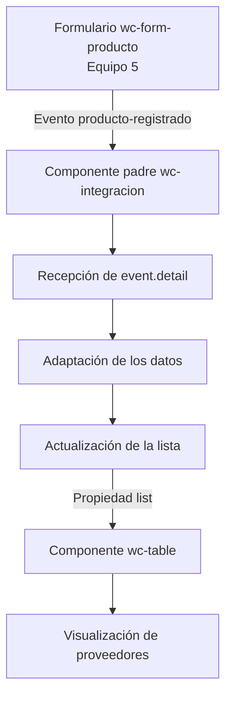

# Grupo 4 – Gestión de proveedores

## 1. Objetivo del proyecto

El objetivo del proyecto es desarrollar un sistema de gestión de proveedores utilizando componentes web con Lit. Se busca mostrar la información de los proveedores mediante una tabla y establecer la comunicación con el formulario de registro de productos desarrollado por el Equipo 5.

La actividad permite aplicar la comunicación entre componentes mediante eventos y propiedades, así como la adaptación de información entre componentes desarrollados por diferentes equipos.

## 2. Arquitectura de los componentes

El proyecto utiliza componentes web desarrollados con Lit. La arquitectura contempla un componente padre encargado de gestionar la información y componentes hijos que permiten registrar y mostrar los datos.

Los componentes principales son:

- **`wc-integracion`:** componente padre encargado de administrar la lista de proveedores y coordinar la comunicación entre los componentes.
- **`wc-form-producto`:** componente externo del Equipo 5 encargado de registrar productos y emitir un evento personalizado.
- **`wc-table`:** componente desarrollado por el Equipo 4 para mostrar los datos recibidos mediante una propiedad.

## 3. Identificación del componente padre e hijos

| Componente | Archivo | Función |
|---|---|---|
| `wc-integracion` | `src/views/integracion/integracion.js` | Componente padre que administra la lista y coordina la integración. |
| `wc-form-producto` | `src/externos/equipo-5/register.js` | Formulario externo que registra productos y emite eventos. |
| `wc-table` | `src/views/home/table.js` | Tabla que recibe y muestra la información de los proveedores. |

## 4. Comunicación mediante eventos

El formulario externo del Equipo 5 utiliza el evento personalizado `producto-registrado` para comunicar que se ha registrado un producto.

El evento transporta información mediante `event.detail`, que contiene los siguientes campos:

- `nombre`
- `categoria`
- `precio`

El componente padre debe escuchar este evento para recibir los datos enviados por el formulario y procesarlos.

## 5. Comunicación mediante propiedades

El componente padre utiliza la propiedad `lista` para almacenar los registros que se muestran en la tabla.

Posteriormente, envía esta información al componente `wc-table` mediante la propiedad `list`.

La comunicación se realiza mediante una propiedad enlazada de Lit:

```javascript
<wc-table .list=${this.lista}></wc-table>
```

De esta manera, la tabla recibe los datos y puede actualizar su contenido cuando cambia la lista.

## 6. Diagrama de flujo Mermaid

El siguiente diagrama representa el flujo previsto de comunicación entre los componentes:



## 7. Adaptación de event.detail

El formulario externo envía los datos del producto con una estructura diferente a la que necesita la tabla de proveedores.

Por este motivo, el componente padre debe adaptar la información recibida mediante `event.detail`.

La correspondencia de los campos es la siguiente:

| Campo recibido | Campo utilizado por la tabla |
|---|---|
| `nombre` | `name` |
| `categoria` | No tiene correspondencia directa. |
| `precio` | No tiene correspondencia directa. |
| No disponible | `ruc` |
| No disponible | `email` |
| No disponible | `phone` |
| No disponible | `address` |

Para completar la estructura esperada por la tabla, los campos sin correspondencia se inicializan como cadenas vacías.

## 8. Dificultades encontradas

Durante el desarrollo se identificaron las siguientes dificultades:

- **Diferencia en la estructura de los datos:** el formulario externo utiliza los campos `nombre`, `categoria` y `precio`, mientras que la tabla espera `name`, `ruc`, `email`, `phone` y `address`.
- **Identificación del archivo externo:** existían archivos llamados `register.js` en diferentes ubicaciones, por lo que fue necesario identificar el archivo correspondiente al Equipo 5.
- **Problemas con el favicon:** el navegador mostraba una solicitud de favicon que generaba una advertencia. Se utilizó `<link rel="icon" href="data:,">` para evitar esa solicitud.
- **Archivos vacíos en GitHub:** algunos archivos aparecían sin contenido después de subirlos al repositorio, por lo que fue necesario volver a cargarlos.
- **Validación del formulario externo:** durante la revisión se identificó que el formulario permite enviar espacios en blanco en los campos de nombre y categoría. Esto puede producir registros con valores vacíos después de aplicar `trim()`.

## 9. Soluciones implementadas

Para resolver las dificultades identificadas se plantearon las siguientes acciones:

- Adaptar los nombres de los campos recibidos mediante `event.detail` a la estructura que necesita la tabla.
- Utilizar la ruta `src/externos/equipo-5/register.js` para identificar y mantener separado el componente externo.
- Agregar la referencia de favicon para evitar solicitudes innecesarias del navegador.
- Volver a subir los archivos que aparecían vacíos en GitHub.
- Documentar el problema de validación del formulario externo y reportarlo al Equipo 5 mediante un issue, sin modificar su código original.

## 10. Evaluación del componente externo

El componente externo del Equipo 5 fue revisado considerando su interfaz, comunicación, robustez, encapsulamiento y posibilidad de reutilización.

| Criterio | Evaluación | Evidencia |
|---|---:|---|
| Claridad de la API | 5/5 | Define el componente y los datos que emite mediante un evento personalizado. |
| Comunicación por eventos | 5/5 | Utiliza `producto-registrado` y permite acceder a los datos mediante `event.detail`. |
| Robustez | 3/5 | Se identificó que permite ingresar espacios en blanco en nombre y categoría. |
| Encapsulamiento | 5/5 | Utiliza componentes Lit y estilos encapsulados. |
| Reutilización | 5/5 | Puede incorporarse en otro proyecto que utilice componentes web compatibles. |

**Observación:** las calificaciones son una propuesta de evaluación basada en la revisión técnica y deben ser confirmadas por el equipo.

El problema de validación fue reportado en el siguiente issue:

[Issue #1 – Revisión del componente externo](https://github.com/byDayLand14/app-lit-grupo5/issues/1).

## 11. Aportes individuales de los integrantes

El trabajo del Grupo 4 se distribuyó entre cuatro integrantes, cada uno con responsabilidades específicas:

| Integrante | Usuario de GitHub | Rol | Aporte |
|---|---|---|---|
| Byron Aguilar | @Raxii | 1 · Integración | Desarrollo inicial del componente padre `integracion.js` y preparación de `integracion.html`. |
| Estefanía Arana | @EstefaniaArana | 2 · Tabla | Desarrollo de `table.js`, implementación de la tabla de proveedores y recepción de la lista mediante propiedades. |
| Carlos Carrasco | @CarlosCarrasco18 | 3 · Revisión externa | Revisión del código original del Equipo 5, identificación de propiedades y eventos, y evaluación técnica del componente. |
| Mateo Villacreses | @Villacreces | 4 · Documentación | Elaboración de `integracion.md` y este README, desarrollo del diagrama Mermaid y documentación de dificultades, soluciones y aportes. |

Cada integrante trabajó en su respectiva rama y realizó sus aportes mediante commits individuales.

## 12. Uso de herramientas de inteligencia artificial

Se utilizó ChatGPT como herramienta de apoyo para organizar y redactar la documentación del proyecto.

Su uso se enfocó en:

- Organizar la información de acuerdo con los puntos solicitados en la actividad.
- Elaborar y revisar el diagrama de flujo Mermaid.
- Mejorar la claridad de las explicaciones técnicas.
- Revisar la estructura y presentación de los archivos Markdown.

La documentación fue contrastada con la guía del taller, los archivos del proyecto y la información disponible en el repositorio. La herramienta se utilizó como apoyo y no como sustituto del trabajo de implementación y revisión realizado por los integrantes.

---

**Repositorio del proyecto:** [Grupo 4 – Gestión de proveedores](https://github.com/Raxii/app-lit-grupo1)

**Repositorio del componente externo:** [Grupo 5 – Gestión de productos](https://github.com/byDayLand14/app-lit-grupo5)
