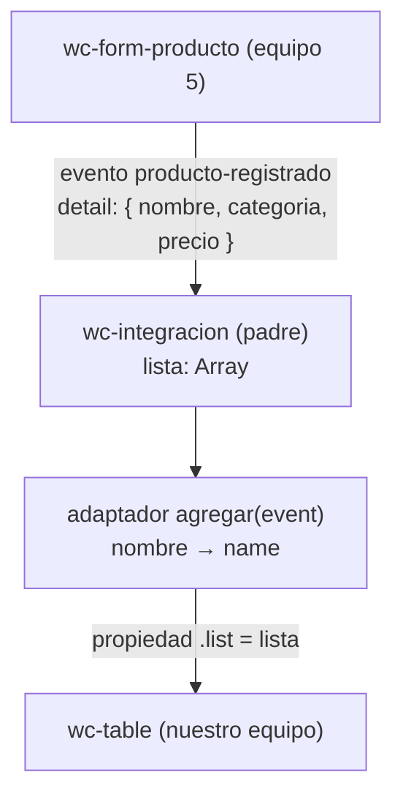

# Integración de componentes Lit · Gestión de proveedores

## 1. Datos

| Campo | Valor |
|---|---|
| Equipo | Equipo 4 · Gestión de proveedores |
| Equipo del componente externo | Equipo 5 · Gestión de productos |
| Repositorio externo | https://github.com/byDayLand14/app-lit-grupo5 |
| Archivo usado | `src/views/home/register.js` → copiado en `src/externos/equipo-5/register.js` |
| Commit usado | `10eba43` |

## 2. Componentes y roles

| Componente | Archivo | Origen | Rol |
|---|---|---|---|
| `<wc-integracion>` | `src/views/integracion/integracion.js` | Nuestro equipo | Padre |
| `<wc-form-producto>` | `src/externos/equipo-5/register.js` | Equipo 5 | Hijo que emite |
| `<wc-table>` | `src/views/home/table.js` | Nuestro equipo | Hijo que recibe |

## 3. Flujo de comunicación

- **Sube por evento:** el formulario del equipo 5 emite `producto-registrado` con `event.detail = { nombre, categoria, precio }`, con `bubbles: true` y `composed: true`. El padre lo escucha con `@producto-registrado="${this.agregar}"`.
- **Baja por propiedad:** el padre pasa `this.lista` a nuestra tabla con `.list="${this.lista}"`.
- **Adaptador:** nuestra tabla espera objetos `{ name, ruc, email, phone, address }`. El método `agregar(event)` del padre convierte `nombre` a `name` y deja `ruc`, `email`, `phone` y `address` vacíos, porque el formulario de productos no envía esos datos. Después crea un arreglo nuevo con `this.lista = [...this.lista, fila]` para que Lit vuelva a renderizar la tabla. El componente del equipo 5 no se modificó.

## 4. Dificultades

| # | Síntoma | Causa | Solución |
|---|---|---|---|
| 1 | Al registrar un producto, la fila aparecía en la tabla solo con la razón social. | El formulario del equipo 5 gestiona productos (`nombre`, `categoria`, `precio`) y nuestra tabla muestra proveedores (`name`, `ruc`, `email`, `phone`, `address`); solo el nombre tiene equivalente. | En el adaptador del padre se convirtió `nombre` a `name` y los campos que no llegan se dejaron vacíos, sin modificar el componente externo ni nuestra tabla. |
| 2 | Después de pegar el componente externo, la página seguía mostrando nuestro formulario de proveedores. | Como los dos archivos se llaman `register.js`, se copió por error nuestro `src/views/home/register.js` en lugar del del equipo 5. | Se copió el `src/views/home/register.js` del repositorio del equipo 5 (commit `10eba43`) y se comprobó que define `wc-form-producto` y emite `producto-registrado`. |
| 3 | La consola mostraba en rojo `favicon.ico: Failed to load resource (404)`. | El navegador busca un ícono para la pestaña y `integracion.html` no tenía ninguno. | Se agregó `<link rel="icon" href="data:," />` en el `<head>` de `integracion.html`; la consola quedó sin errores. |
| 4 | Al descargar el repositorio del equipo desde GitHub, varios archivos estaban vacíos (0 bytes). | Los archivos se crearon en la rama principal sin contenido. | Se subieron los archivos completos en la rama `taller-integracion`. |

## 5. Evaluación del componente externo

| Aspecto | Nota (0–5) | Evidencia |
|---|---|---|
| API clara | 5 | El README.md esta bien echo ya del equipo 5 esta indicando la etiqueta wc-form-producto, el evento producto-registrado y la estructura de event.detail ({ nombre, categoria, precio }). Lo integramos sin revisar su código para adivinar nombres (register.js, líneas 16 y 35). |
| Evento bien construido | 5 | Envía los datos en detail y usa bubbles: true y composed: true, es por este motivo que el evento cruza el Shadow DOM y llega a wc-integracion. Además convierte el precio a número con Number() (register.js, líneas 16 a 20). |
| Robustez | 3 | el grupo 5 esta cumpliendo con el formulario vacío ya que no deja enviar y no acepta precios negativos (required y min="0", líneas 27 a 29). Pero encontramos un error en donde si se escriben solo espacios en Nombre y Categoría, el required los acepta, el .trim() los deja vacíos y se registra una fila sin nombre (register.js, líneas 17 y 27-28). |
| Encapsulamiento | 5 | Sus estilos están dentro de su Shadow DOM (static styles, líneas 4 a 10): su botón verde no esta chocando con nuestro diseño y también pudimos notar que tampoco alteró los estilos de nuestra página ni de nuestra tabla. |
| Reutilización | 5 | Copiamos solo src/views/home/register.js del equipo 5 en nuestra carpeta src/externos/equipo-5/ sin modificar ninguna línea. Solo depende de lit (línea 1) y no necesitó otros archivos de su proyecto y funciono correctamente. |

Issue abierto en el repositorio del equipo 5: https://github.com/byDayLand14/app-lit-grupo5/issues/1

## 6. Uso de IA

| Herramienta | Quién la usó | Para qué | Qué cambiamos nosotros |
|---|---|---|---|
| | | | |

## 7. Aportes del equipo

| Integrante | Rol | Commits |
|---|---|---|
| Byron | Rol 1 · Integración | |
| Estefanía | Rol 2 · Adaptador y pruebas | |
| Carlos | Rol 3 · Revisión externa | |
| Mateo | Rol 4 · Documentación | |